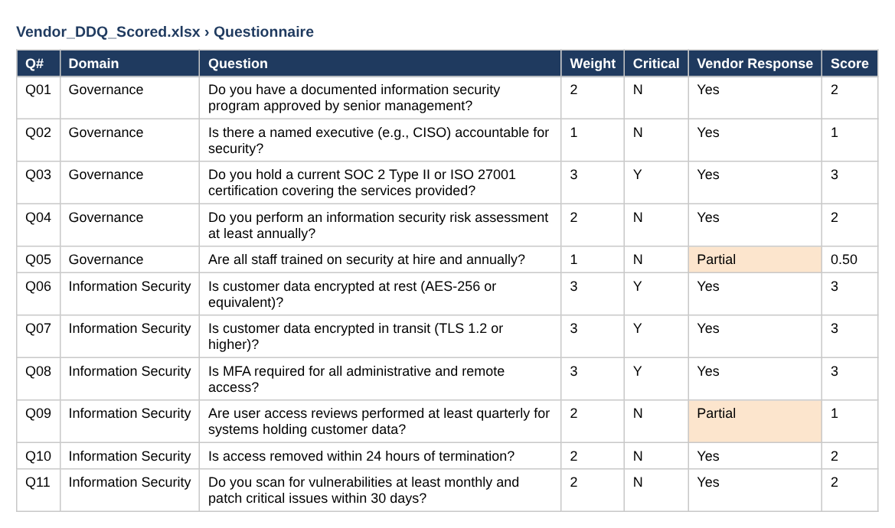
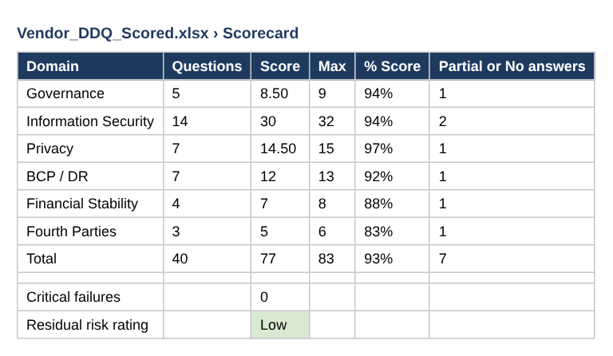
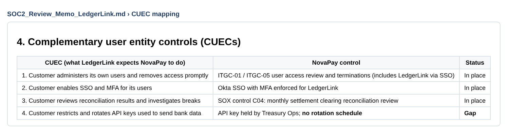
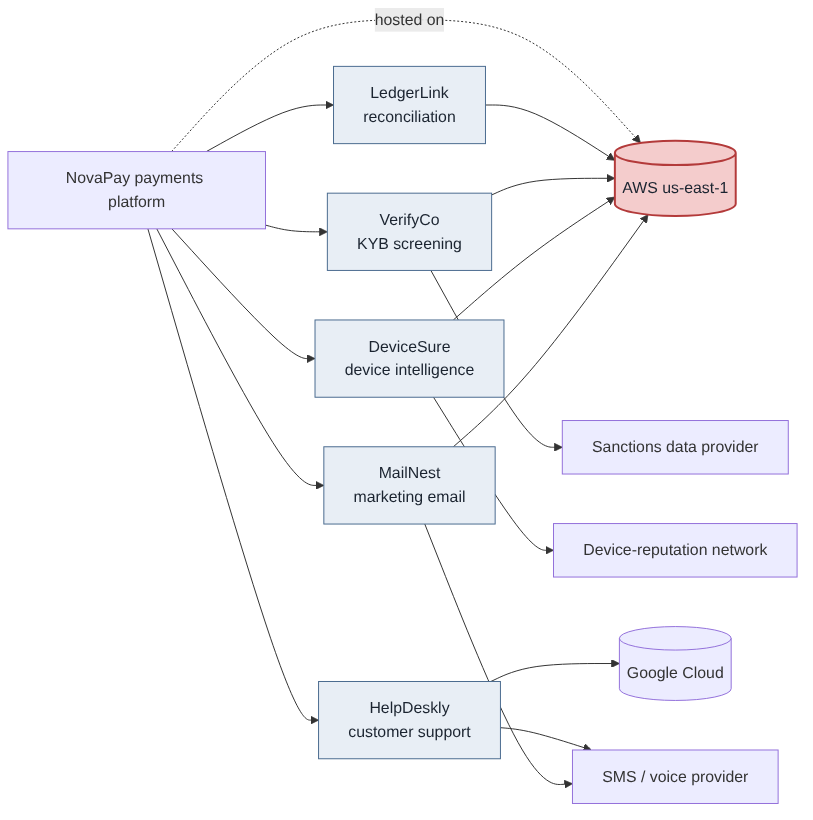
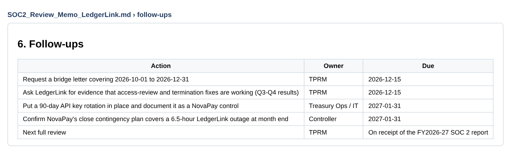

# Evidence: Third-Party Risk Program

Due diligence → SOC report review → concentration risk → remediation.

> Screenshots are taken from the files in this repository. Data is fictional or simulated.

## Step 1 · Built: scored questionnaire

40 weighted questions with critical knockouts.

## Step 2 · Verified: vendor scorecard

Sample vendor: 93% weighted score, no critical failures, 7 follow-ups.

## Step 3 · Broken: SOC 2 report review findings

3 exceptions in the vendor's report and 1 gap on NovaPay's side (API key rotation).

## Step 4 · Broken: concentration risk

4 of 5 critical vendors and NovaPay itself depend on one cloud region.

## Step 5 · Remediation: follow-ups

Bridge letter, vendor evidence, API key rotation, contingency check.

