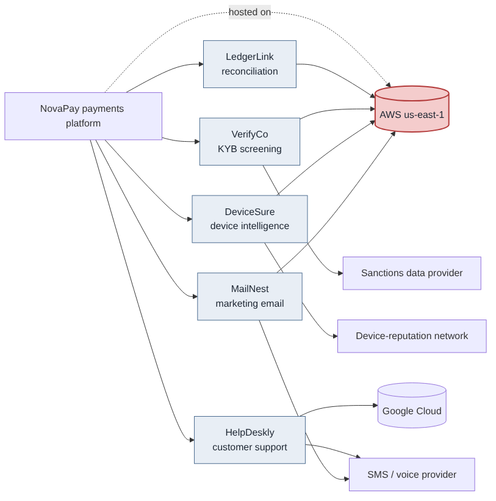

# Fourth-Party & Concentration Risk Map

**Skills shown:** sub-processor (fourth-party) mapping, concentration risk analysis, contract clause design, exit planning, 2023 Interagency Guidance on Third-Party Relationships.

> NovaPay and its five vendors are fictional. The cloud providers are real companies used as illustrative dependencies; in a real review, sub-processors come from each vendor's published sub-processor list and SOC 2 report.

## Case study

| | |
|---|---|
| **Why I built this** | Regulators now expect banks and fintechs to understand their vendors' vendors. |
| **Explain** | A map of who our top vendors depend on, and where too much sits in one place. |
| **What was broken** | 4 of 5 critical vendors and our own platform run in the same cloud region; one screening vendor depends on a single data provider. |
| **What was fixed** | Contract clauses for sub-processor notice and data location, exit plans for each vendor, a backup screening vendor. |
| **Business impact** | One regional outage no longer stops onboarding, payments and close at the same time. |
| **Remediation still open** | Assess a second region for the platform; add hosting fields to the vendor inventory. |
| **Decisions and trade-offs** | I accepted the cost-heavy option (cross-region replication) as a later budget item instead of mandating it now. |

## Details

## The map

## NovaPay's top 5 vendors and their fourth parties

| Vendor | Service | Tier | Hosting | Other critical fourth parties | Supports |
|---|---|---|---|---|---|
| LedgerLink | Bank reconciliation | High | AWS us-east-1 | None material | SOX key control C04 |
| VerifyCo | KYB / sanctions screening | Critical | AWS us-east-1 | Sanctions data provider | Merchant onboarding (BSA/AML) |
| DeviceSure | Device intelligence for fraud scoring | High | AWS us-east-1 | Device-reputation network | Real-time fraud decisions |
| HelpDeskly | Customer support platform | Medium | Google Cloud | SMS / voice provider | Merchant support |
| MailNest | Marketing email | Low | AWS us-east-1 | SMS / voice provider | Campaigns |

## Concentration findings

1. **One cloud region behind most critical services.** NovaPay's own platform and 4 of its 5 top vendors run in AWS us-east-1. A regional outage could take down payments, onboarding screening, fraud scoring and reconciliation at once, and switching vendors would not help.
2. **Onboarding has a single path.** VerifyCo depends on one sanctions data provider; if either fails, NovaPay cannot meet its screening duty and must pause onboarding.
3. **Shared communications provider.** HelpDeskly and MailNest use the same SMS / voice provider, so a failure there affects both support and customer notices. Lower impact.
4. **Visibility gap.** Only 2 of 5 contracts require notice before a vendor adds or changes a sub-processor.

## Recommendations

### Contract clauses (add at renewal)
| Clause | Why |
|---|---|
| Sub-processor list, with 30 days' notice and a right to object before changes | Keeps the fourth-party map current |
| Flow-down of security, confidentiality and audit terms to sub-processors | NovaPay's protections follow the data |
| Business continuity and DR commitments, with annual test results shared | Evidence that recovery targets are met |
| Data location commitments, and notice of any region change | Lets NovaPay track regional concentration |
| Incident notification within 72 hours, including incidents at sub-processors | Fourth-party breaches reach NovaPay quickly |
| Termination assistance and data return in a usable format | Makes exit possible |

### Exit and resilience plans
| Vendor | Exit / fallback plan | Target time to switch |
|---|---|---|
| VerifyCo (Critical) | Pre-contract a second screening vendor on a different cloud; keep a manual screening procedure for outages | Fail over in 1 day; full switch 60 days |
| DeviceSure | Fraud engine falls back to rules-only scoring with tighter limits | Immediate (automatic) |
| LedgerLink | Spreadsheet reconciliation procedure documented and tested at one month-end per year | 1 close cycle |
| HelpDeskly | Email-only support fallback | 1 day |
| MailNest | Pause campaigns; export lists quarterly | Not time-critical |

### Program changes
- Add "hosting provider and region" and "critical sub-processors" as required fields in the vendor inventory.
- Report concentration to the Risk Committee each quarter: share of critical services on each cloud provider and region.
- Ask NovaPay Engineering to assess a second AWS region for the payments platform.

## Regulatory link
The 2023 Interagency Guidance on Third-Party Relationships (Federal Reserve, FDIC, OCC) expects banks, and in practice their fintech partners, to consider subcontractor dependencies and concentration risk across the third-party lifecycle: planning, due diligence, contract negotiation, ongoing monitoring and termination.
