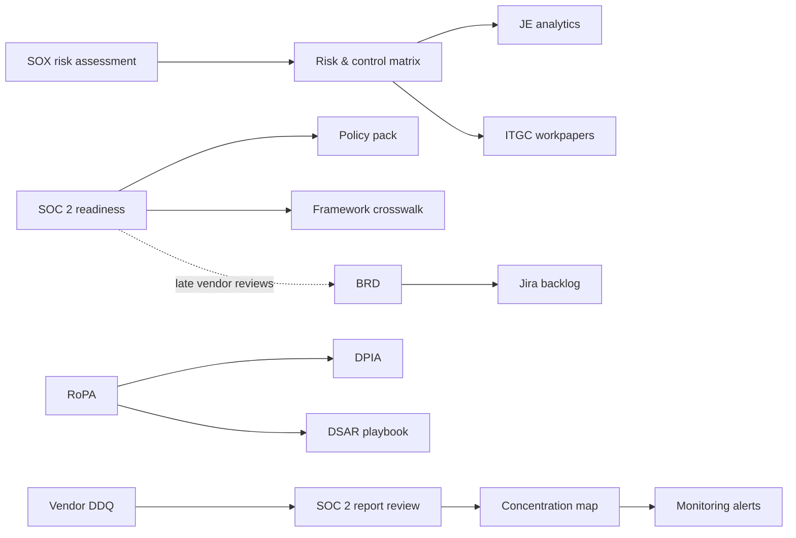

# NovaPay Risk, Compliance & Analytics Portfolio

Hands-on projects by **Naa Aboagye**, built around **NovaPay**, a fictional U.S. card-payments fintech. They draw on 10 years in audit, controls and SOX assurance at global banks and in financial services and extend it into GRC, privacy, third-party risk, business analysis and data analytics.

> All companies, vendors and data are fictional or synthetic. No employer information is used.

## How each project is written
Every project page opens with a **case study**: why I built it, what was broken, what was fixed, the business impact, what remediation is still open, and the decisions and trade-offs behind it. The detailed work follows underneath.

## Start here

| If you're hiring for... | Look at |
|---|---|
| **SOX / Internal Audit / Risk** | [Journal entry analytics](sox-risk-bi/01-je-full-population-testing/) · [SOX RCM](sox-risk-bi/02-sox-risk-assessment-rcm/) · [ITGC workpapers](grc/03-itgc-control-testing/) |
| **GRC Analyst** | [SOC 2 readiness](grc/01-soc2-readiness/) · [Policy pack](grc/02-policy-pack/) · [Framework crosswalk](grc/04-framework-crosswalk/) |
| **Third-Party Risk** | [SOC 2 report review](tprm/01-soc2-report-review/) · [Due-diligence questionnaire](tprm/02-due-diligence-questionnaire/) · [Concentration risk](tprm/03-fourth-party-concentration/) |
| **Privacy Analyst** | [RoPA & data map](privacy/01-ropa-data-inventory/) · [DPIA](privacy/02-dpia-ai-fraud-scoring/) · [DSAR playbook](privacy/03-dsar-playbook/) |
| **Business Analyst** | [BRD + traceability](business-analyst/01-brd-vendor-review-reminders/) · [Process redesign](business-analyst/02-onboarding-process-redesign/) · [Agile backlog](business-analyst/03-agile-backlog/) |
| **BI / Data** | [Journal entry analytics (SQL, Python)](sox-risk-bi/01-je-full-population-testing/) · [Benefit model](business-analyst/02-onboarding-process-redesign/) |

## All projects

| Area | Projects |
|---|---|
| [SOX, Risk & BI](sox-risk-bi/) | Full-population JE testing (24,000 entries, 6 SQL tests) · SOX risk assessment & RCM · Deficiency evaluation field guide |
| [GRC](grc/) | SOC 2 readiness (36 criteria) · 5-policy pack · ITGC testing workpapers (5 controls, 1 deficiency memo) · 30-control framework crosswalk |
| [Privacy](privacy/) | RoPA (10 activities) + data-flow diagram · DPIA for AI fraud scoring · DSAR playbook + tracker · Cookie audit toolkit |
| [Third-Party Risk](tprm/) | SOC 2 Type II review memo · 40-question scored DDQ · Fourth-party concentration map · Vendor incident alerts |
| [Business Analysis](business-analyst/) | BRD + RTM · As-is / to-be onboarding redesign · Jira backlog (14 stories) · Stakeholder interviews & gap analysis |

## How the projects connect

## Frameworks and tools
**Frameworks:** COSO 2013 · PCAOB AS 2201 / AS 2401 · SOC 2 (TSC) · NIST CSF 2.0 · ISO/IEC 27001:2022 · PCI DSS v4.0 · GDPR · CCPA/CPRA · GLBA · BSA/AML · 2023 Interagency Guidance on Third-Party Relationships · ASC 326 / ASC 606
**Tools:** Excel (formula-driven workbooks) · SQL · Python (pandas, Playwright) · Jira · Mermaid / process modeling

## Contact
[LinkedIn](https://www.linkedin.com/in/naaa-aboagye/)
