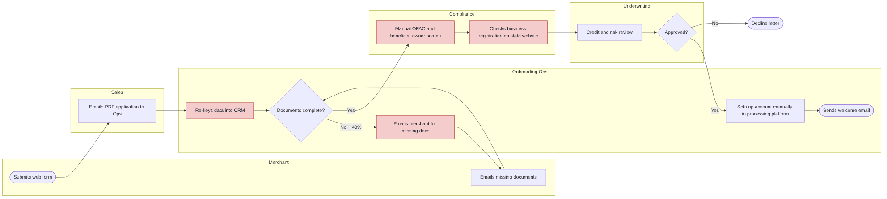
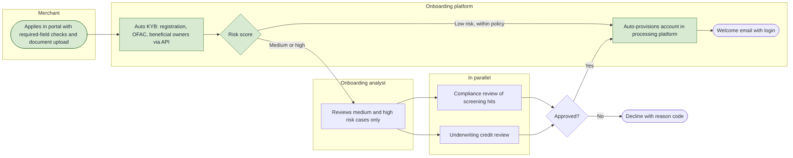

# As-Is / To-Be Redesign: Merchant Onboarding

**Skills shown:** process mapping (swimlane / BPMN-style), bottleneck analysis, future-state design, benefit estimation.

## Case study

| | |
|---|---|
| **Why I built this** | Process improvement is a skill I've used in controls work; I wanted to show it with before-and-after maps and numbers. |
| **Explain** | Merchant onboarding took 9 days. I mapped the current process, found the bottlenecks and designed a better one. |
| **What was broken** | Re-keying data, a document-chasing loop on 40% of applications, manual sanctions checks and sequential reviews. |
| **What was fixed** | Portal with required fields and upload, automated KYB screening, risk-based routing, parallel reviews, automatic account setup. |
| **Business impact** | Estimated 9 → 2 days and about 8,280 staff hours saved a year (illustrative model). |
| **Remediation still open** | Validate the model's assumptions with a time study; keep quarterly sample reviews of auto-approvals. |
| **Decisions and trade-offs** | I kept a human review on every sanctions hit and for medium/high-risk merchants: speed should not remove the AML control. |

## Details

**Scenario:** NovaPay onboards ~300 small-business merchants a month. It takes **9 business days** from application to a live account, and 40% of applications stall waiting for missing documents.

## As-is process

### Bottlenecks found (red in the diagram)

| # | Bottleneck | Effect |
|---|---|---|
| 1 | Sales emails a PDF; Ops re-keys it into the CRM | ~45 min per application, typing errors |
| 2 | Missing documents found only after submission (~40%) | Email loop adds 2-4 days |
| 3 | Manual OFAC, beneficial-owner and state-registration searches | ~60 min per application; inconsistent evidence for audit |
| 4 | Compliance and underwriting work one after the other | Queue time doubles |
| 5 | Every application gets the same manual review, whatever its risk | Analyst time spent on low-risk merchants |

## To-be process

### Design changes

1. **Merchant portal with required-field checks and document upload:** no re-keying, far fewer missing documents.
2. **Automated KYB** (business registration, OFAC sanctions, beneficial ownership) through a screening API, with results saved as audit evidence.
3. **Risk-based routing:** low-risk merchants within policy are approved automatically; analysts review only medium and high risk.
4. **Compliance and underwriting in parallel** for routed cases.
5. **Automatic account provisioning** in the processing platform.

Controls kept: sanctions screening on 100% of applicants, human review of every screening hit, and a quarterly sample review of auto-approvals.

## Estimated benefit

From [Onboarding_Benefit_Estimate.xlsx](Onboarding_Benefit_Estimate.xlsx) (all formulas; inputs are illustrative assumptions you can change):

| Measure | As-is | To-be | Change |
|---|---:|---:|---:|
| Cycle time (business days) | 9 | 2 | -78% |
| Staff touch time per application (hours) | 3.5 | 1.2 | -66% |
| Applications missing documents | 40% | 10% | 1,080 fewer follow-ups a year |
| Staff hours per year | | | **8,280 saved (~$455k at $55/hour)** |

## Files

| File | What it is |
|---|---|
| `as_is.mmd`, `to_be.mmd` | Diagram source (Mermaid); GitHub renders it, and it can be redrawn in draw.io or Lucidchart |
| `as_is.png`, `to_be.png` | Rendered diagrams |
| `Onboarding_Benefit_Estimate.xlsx` | Benefit model with editable assumptions |
