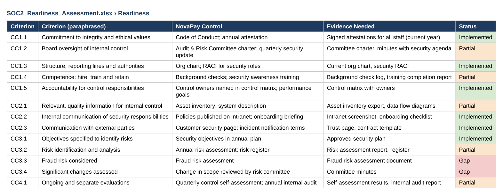
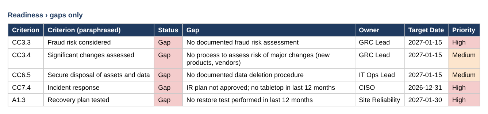
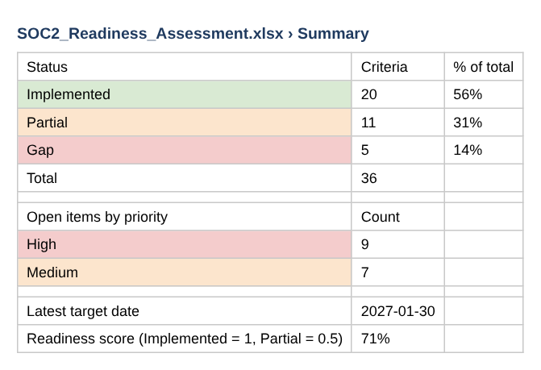
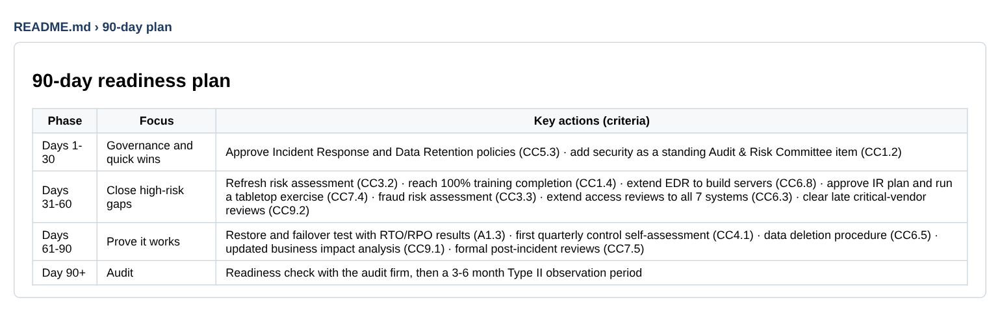
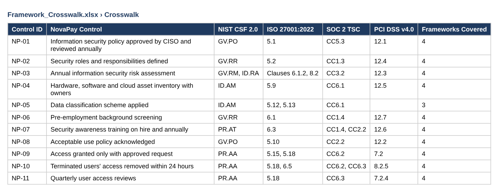

# Evidence: SOC 2 Readiness Assessment

Assessment → gaps → plan.

> Screenshots are taken from the files in this repository. Data is fictional or simulated.

## Step 1 · Built: criteria assessment

All 36 Security and Availability criteria assessed with the evidence an auditor would request.

## Step 2 · Broken: the gaps

5 gaps and 11 partial criteria, each with an owner and target date.

## Step 3 · Verified: readiness score

71% ready (Implemented = 1, Partial = 0.5).

## Step 4 · Remediation: 90-day plan

Phased plan starting with the highest-risk gaps.

## Step 5 · Built: framework crosswalk

Same controls mapped to NIST CSF 2.0, ISO 27001, SOC 2 and PCI DSS (from the crosswalk project).

