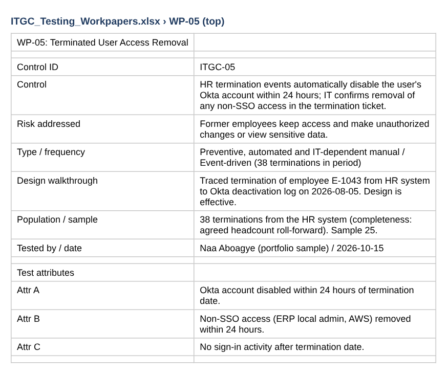
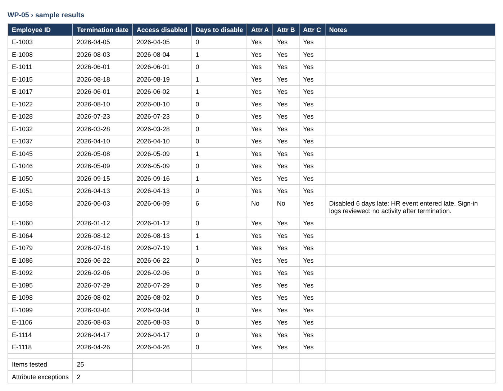
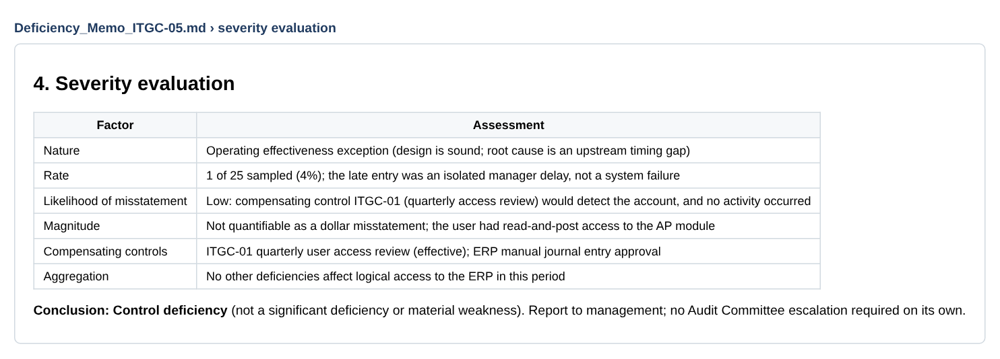
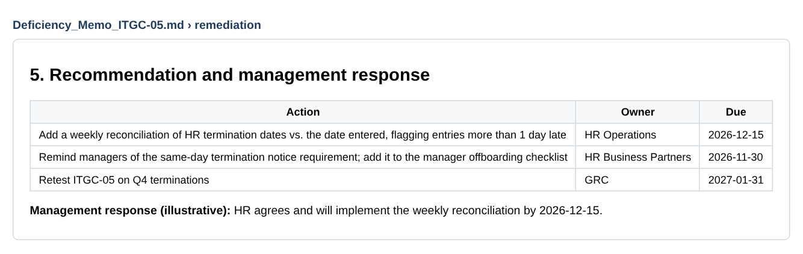
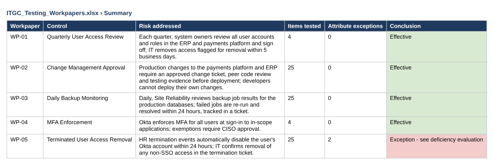

# Evidence: ITGC Control Testing

Walkthrough, sample testing, exception, deficiency evaluation, remediation.

> Screenshots are taken from the files in this repository. Data is fictional or simulated.

## Step 1 · Built: test design for terminations

Control, risk, walkthrough and test attributes documented before testing.

## Step 2 · Broken: the exception in the sample

1 of 25 terminated users kept access for 6 days.

## Step 3 · Fixed: deficiency memo

Condition, cause, effect and severity evaluated; rated a control deficiency.

## Step 4 · Remediation: corrective actions

Owners and dates for the fix and the retest.

## Step 5 · Verified: results across all 5 controls

Summary of the full test program.

