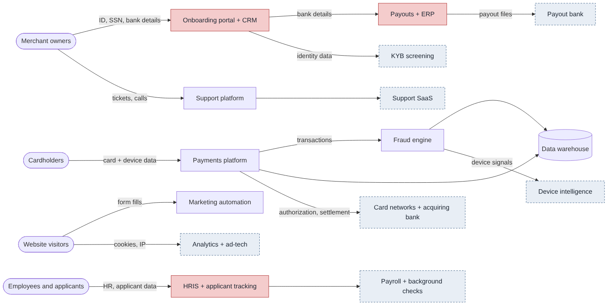

# Data Inventory & Record of Processing Activities (RoPA)

**Skills shown:** data mapping, GDPR Article 30 records, legal-basis analysis, transfer safeguards, identifying where a DPIA is needed, CCPA/CPRA and GLBA analysis.

## Case study

| | |
|---|---|
| **Why I built this** | You can't protect data you haven't mapped; every privacy program starts with an inventory. |
| **Explain** | I mapped 10 personal-data flows: what's collected, why, the legal basis, who gets it and how long it's kept. |
| **What was broken** | Fraud scoring profiles cardholders without a DPIA; advertising cookies count as 'sharing' under CPRA without an opt-out. |
| **What was fixed** | Flagged two activities for DPIAs, added the opt-out and Global Privacy Control requirement, and corrected GLBA vs. CCPA applicability. |
| **Business impact** | Clear legal basis and notices for each activity reduces regulatory exposure. |
| **Remediation still open** | DPIA for KYB onboarding; annual RoPA review. |
| **Decisions and trade-offs** | I treated merchant owners as CCPA consumers, not GLBA customers, because they use the service for business, which changes which rights apply. |

## Details

**Scenario:** NovaPay is U.S.-based and serves some EU merchants, so GDPR applies to EU personal data. U.S. data falls under CCPA/CPRA (including merchant-owner, employee and applicant data); GLBA would apply if NovaPay offers financial products to consumers.

## Data-flow diagram

Red = systems holding sensitive data (government IDs, SSNs, bank accounts). Dashed = vendors and partners outside NovaPay.

## RoPA summary

| Measure | Count |
|---|---:|
| Processing activities | 10 |
| Involving sensitive or high-risk data | 4 |
| With cross-border transfers (EU-U.S. DPF or SCCs) | 7 |
| DPIA required | 2 (merchant KYB, fraud scoring) |

Legal bases used: contract, legal obligation (AML/KYC, disputes, payroll), legitimate interests (fraud prevention, recruiting), and consent (marketing and advertising cookies for EU visitors).

## Key observations
1. **Fraud scoring (PA-03) profiles cardholders** using device and location signals, so a DPIA is required ([see DPIA project](../02-dpia-ai-fraud-scoring/)).
2. **Advertising cookies (PA-08)** count as "sharing" under CPRA, so the site needs a "Do Not Sell or Share" link and must honor Global Privacy Control.
3. **Merchant owners are business customers**, so GLBA generally doesn't cover their data. CPRA's business-to-business exemption ended in 2023, so their CCPA rights apply. If NovaPay launches a consumer product (e.g., a cardholder wallet), GLBA privacy notices and the FTC Safeguards Rule would apply, and that data would be largely exempt from CCPA.
4. **Retention** follows the Data Retention policy ([POL-05](../../grc/02-policy-pack/POL-05_Data_Retention_and_Disposal_Policy.md)).

## Files
| File | What it is |
|---|---|
| [RoPA_Data_Inventory.xlsx](RoPA_Data_Inventory.xlsx) | 10 activities: data subjects, data categories, purpose, legal basis, U.S. notice, systems, vendors, retention, transfers, DPIA flag; summary tab with formulas |
| `data_flow.mmd` / `data_flow.png` | Diagram source and image |
