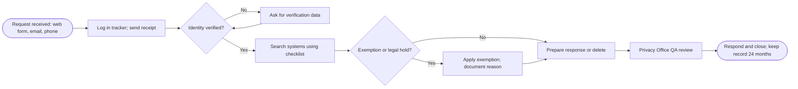

# Data Subject Request (DSAR) Playbook: Access and Deletion

| Field | Detail |
|---|---|
| Owner | Privacy Office |
| Applies to | Requests from merchants' owners and users, cardholders, website visitors, employees and applicants |
| Laws covered | GDPR (EU individuals), CCPA/CPRA (California residents) |
| Tracker | [DSAR_Tracker.xlsx](DSAR_Tracker.xlsx) |

> NovaPay is fictional. Timelines reflect GDPR Article 12 and the CCPA regulations; confirm current rules with counsel before use.

## 1. Deadlines at a glance

| Step | GDPR | CCPA/CPRA |
|---|---|---|
| Confirm receipt | No fixed rule; NovaPay confirms within 3 business days | Within **10 business days** |
| Respond (access, deletion, correction) | **One month** from receipt | **45 calendar days** from receipt |
| Extension | Up to **two more months** if complex or numerous; tell the person within the first month, with reasons | One extension of **45 more days** (90 total); tell the person within the first 45 days, with reasons |
| Opt-out of sale/sharing | N/A (objection / consent withdrawal: act without undue delay) | As soon as feasibly possible, no later than **15 business days** |
| Fee | Free (unless manifestly unfounded or excessive) | Free (limit: twice in 12 months for access) |

## 2. Process

### Step 1: Intake (Day 0)
- Accepted channels: privacy web form, privacy@novapay.example, toll-free number (CCPA requires two methods).
- Log the request in the tracker the same day: regime, type, received date. The tracker calculates the deadlines.
- Agents (e.g., someone acting for the person under CCPA) need signed written permission.

### Step 2: Verify identity
| Request | Verification standard |
|---|---|
| Merchant user with an account | Sign in to the existing authenticated account |
| Access to categories of data, or deletion of non-sensitive data | Match **2 data points** we hold (e.g., email + last 4 digits of the card used) |
| Access to specific pieces of data, or deletion of sensitive data | Match **3 data points** plus a signed declaration (CCPA "reasonably high degree of certainty") |
| Cannot verify after 2 attempts | Close as unverifiable; tell the person why; for CCPA deletion, treat as an opt-out of sale/sharing |

Never ask for more data than needed, and use verification data only for verification.

### Step 3: Search systems (checklist)
| System | Owner | Search by | Notes |
|---|---|---|---|
| CRM and onboarding portal | Merchant Ops | Email, business name, TIN | Includes KYB documents |
| Payments platform | Engineering | Card token, email | Transaction records |
| Fraud engine and data warehouse | Data Science | Card token, device ID | Model features |
| Disputes tool | Disputes Ops | Card token, case ID | |
| Support platform | Support | Email, phone | Includes call recordings |
| Marketing automation | Marketing | Email | Include suppression list |
| HRIS / applicant tracking | HR | Name, employee ID | Employees and applicants only |
| Backups | IT | n/a | Deleted as backups expire; restored data is re-deleted |
| Vendors (processors / service providers) | Privacy Office | As above | Forward deletion requests and get confirmation |

### Step 4: Apply exemptions
Common reasons to keep data despite a deletion request (document every one):
- **Legal obligation:** KYC and transaction records must be kept 5 years under the Bank Secrecy Act.
- **Legal claims and holds:** active disputes, litigation or regulatory requests.
- **Fraud and security:** data needed to detect fraud or security incidents.
- **Complete the transaction** or contract the person asked for.
- **Data covered by GLBA** (if NovaPay offers consumer financial products) is largely exempt from CCPA rights.

Data kept under an exemption is restricted to that purpose. Tell the person what was kept and why.

### Step 5: Respond
- **Access:** provide a copy in a commonly used electronic format (CSV or PDF) through the secure portal, never by plain email. Include categories, sources, purposes, recipients and retention (GDPR Art. 15 items).
- **Deletion:** delete or de-identify across systems; instruct service providers; add the email to the marketing suppression list so the person isn't re-added.
- Use the response templates below; the Privacy Office reviews each response before it is sent.

### Step 6: Close and report
- Record completion date, outcome and any exemptions in the tracker. Keep DSAR records for 24 months (CCPA recordkeeping).
- Report monthly: volume, on-time rate, average days to close, extensions used.

## 3. Response templates

**Acknowledgment**
> Subject: We received your privacy request (Ref. {{ID}})
> We received your request on {{date}} to {{access / delete}} your personal information. To protect your information, we need to confirm your identity: please reply with {{verification items}}. We will respond by {{due date}}.

**Extension notice**
> We need more time to complete your request (Ref. {{ID}}) because {{reason}}. We will respond by {{extended due date}}.

**Deletion completed, with exemption**
> We have deleted your personal information from our systems and asked our service providers to do the same. We are required by law to keep {{records}} until {{date}} under {{law}}. This information is used only for that purpose and will be deleted afterwards.

**Unable to verify**
> We could not verify your identity, so we cannot complete your request (Ref. {{ID}}). You can submit a new request at any time. {{CCPA deletion only: We have treated your request as a request to opt out of the sale or sharing of your personal information.}}

## 4. Roles
| Role | Responsibility |
|---|---|
| Privacy Office | Owns the process, verifies identity, applies exemptions, QA, reporting |
| System owners | Search and delete within 5 business days of the Privacy Office request |
| Legal | Advises on exemptions, legal holds and complex requests |
| Support | Routes requests received through support channels to the Privacy Office the same day |
