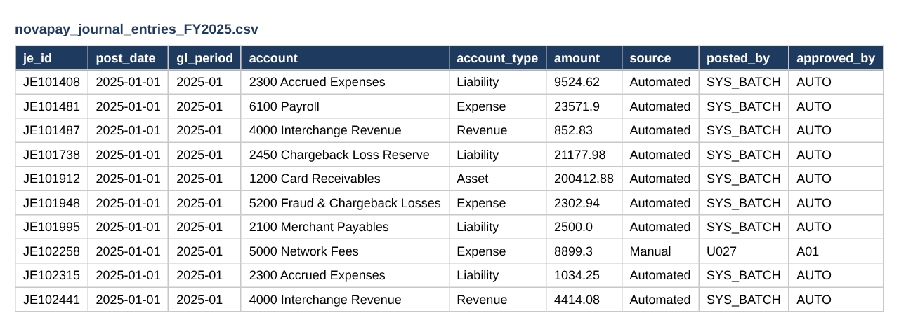
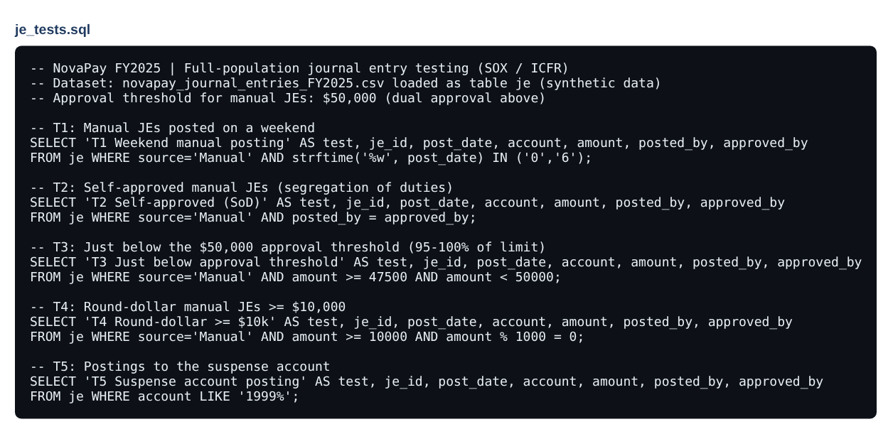
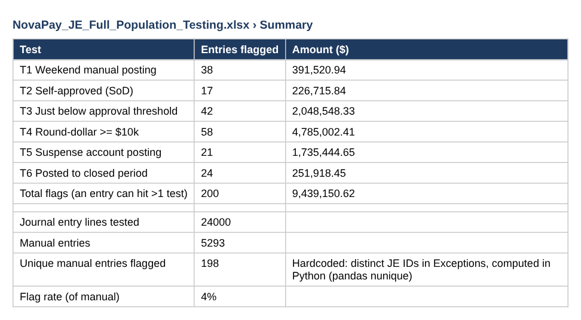
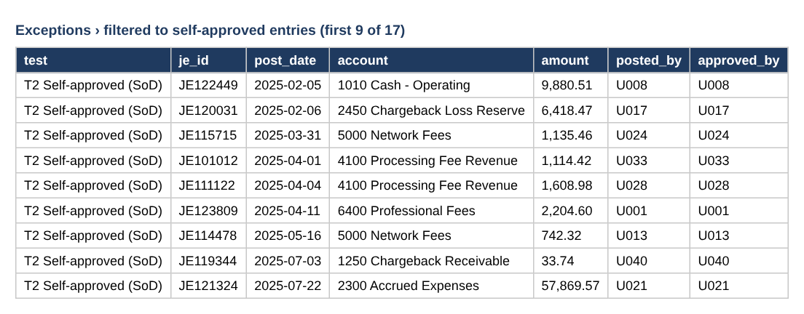
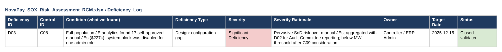
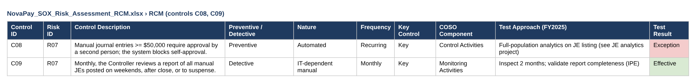

# Evidence: Full-Population Journal Entry Testing

From raw data to a fixed control, in the order the work was done.

> Screenshots are taken from the files in this repository. Data is fictional or simulated.

## Step 1 · Built: the full population

24,000 FY2025 journal entry lines loaded for testing (first rows shown).

## Step 2 · Built: the SQL risk tests

Six tests written in SQL; each one targets a known journal-entry risk.

## Step 3 · Broken: what the tests found

198 unique manual entries flagged across the six tests.

## Step 4 · Broken: the segregation-of-duties failures

17 manual entries posted and approved by the same person.

## Step 5 · Fixed: control finding and remediation

Root cause: ERP approval block disabled for one admin role. Logged as deficiency D03, remediated and validated.

## Step 6 · Remediation: tests become a monthly control

The six tests now feed control C09, the Controller's monthly review of risky manual entries.

