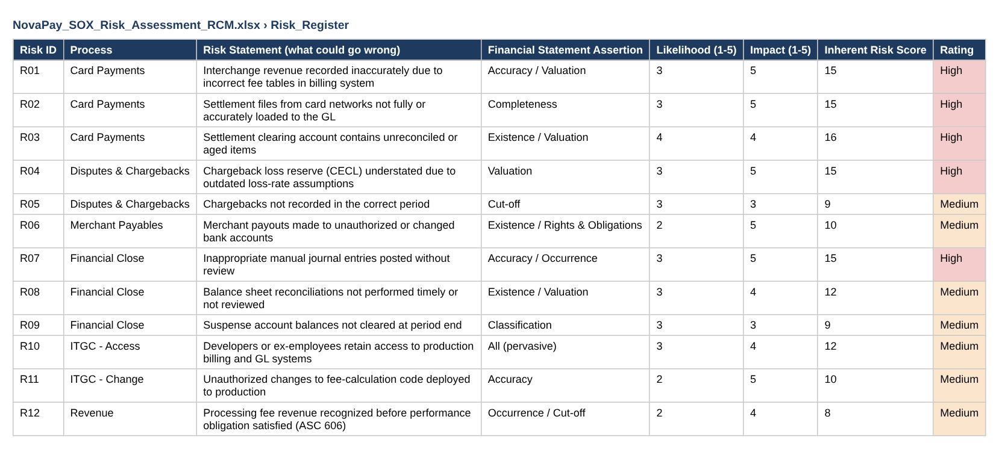
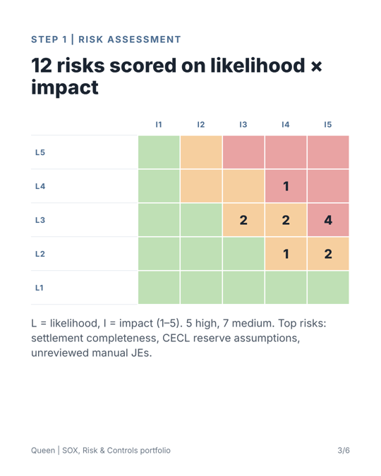
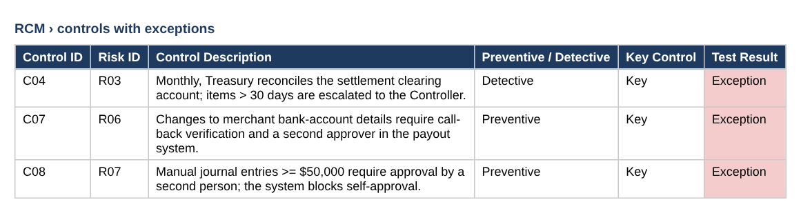
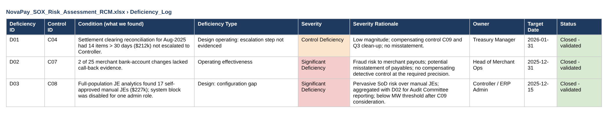
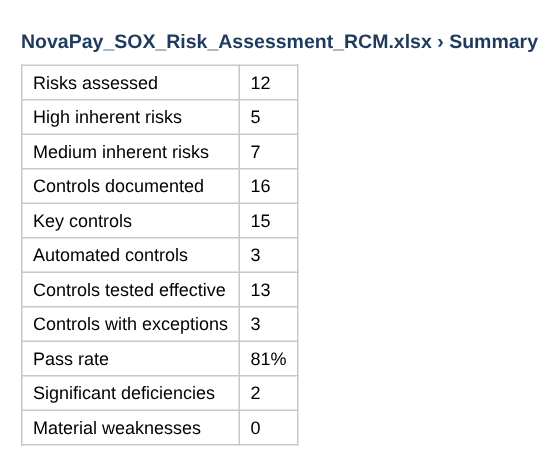

# Evidence: SOX Risk Assessment & Risk and Control Matrix

Risk → control → test → deficiency → remediation.

> Screenshots are taken from the files in this repository. Data is fictional or simulated.

## Step 1 · Built: risk register

12 financial-reporting risks scored likelihood × impact.

## Step 2 · Built: heat map

Where the risks sit; 5 are High.

## Step 3 · Broken: control testing exceptions

3 of 16 controls had exceptions in FY2025 testing.

## Step 4 · Fixed: deficiency evaluation

Each exception rated with a written rationale: 1 control deficiency, 2 significant deficiencies, no material weakness.

## Step 5 · Remediation: program summary

Formula-driven summary for management and the Audit Committee.

