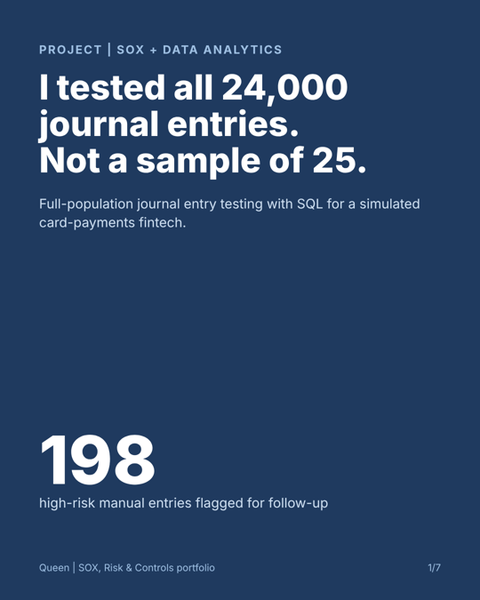
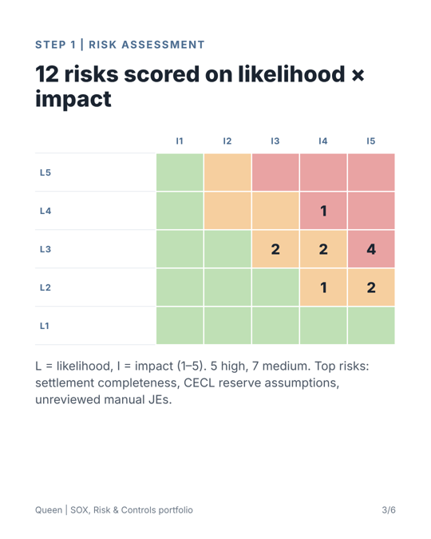
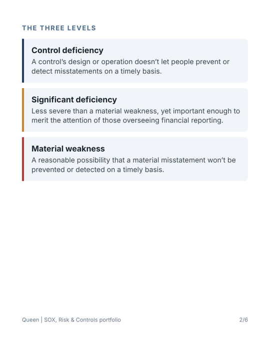

# SOX, Risk & BI Projects

| # | Project | Skills shown |
|---|---------|--------------|
| 1 | [Full-population journal entry testing](01-je-full-population-testing/) | SOX, ICFR, SQL, Python, data analytics, segregation of duties |
| 2 | [SOX risk assessment & Risk and Control Matrix](02-sox-risk-assessment-rcm/) | Risk assessment, COSO 2013, control design and testing, deficiency evaluation |
| 3 | [Field guide: deficiency vs. significant deficiency vs. material weakness](03-deficiency-evaluation-guide/) | PCAOB AS 2201, ICFR judgment, Audit Committee reporting |

  
